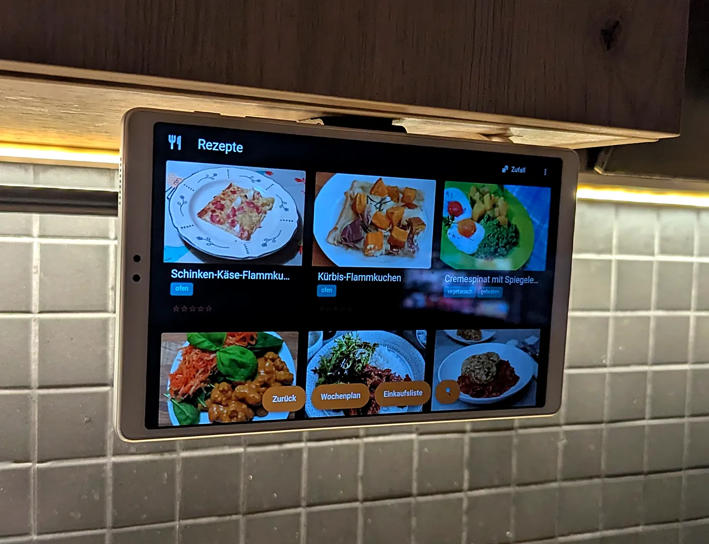

# Mealie Kiosk

Android home-screen app that turns a wall-mounted tablet into a kitchen display for a self-hosted
[Mealie](https://github.com/mealie-recipes/mealie) server.



- Fullscreen WebView on your Mealie server, landscape, system bars hidden. Other hosts are blocked.
- Kiosk layout without server changes: no app bar or drawer, three recipe columns, and a button row
  for Back, Meal plan, Shopping list and Search. German labels when the tablet language is German.
- Flip-down mount support: stowed flat under a cabinet with the screen facing down, the display
  sleeps; flipped down past 50 degrees it wakes into the recipe list (40 degrees back, held 400 ms).
- Offline German voice commands in Mealie's cook mode (Vosk). The microphone is off everywhere else.
- Retries every 5 s while Mealie is not reachable, for example when Wi-Fi is not up after boot.

The mount build guide (parts, drilling, cable routing) is on the project page:
[English](https://it-baer.github.io/mealie-kiosk/) · [Deutsch](https://it-baer.github.io/mealie-kiosk/de.html).

## Requirements

- Android 14 or newer (minSdk 34), arm64. Tested on one device only: Samsung Galaxy Tab A7 Lite
  (SM-T220, Android 14). Other tablets should work, but the wake and sleep path uses Samsung-specific
  settings below.
- A Mealie server reachable from the tablet. Tested with Mealie 3.26.0. The kiosk layout uses
  Mealie's CSS class names, so a Mealie update can break it.
- A PC with `adb` and USB or wireless debugging enabled on the tablet.

## Install

Download `mealie-kiosk-<version>.apk` from [Releases](https://github.com/IT-BAER/mealie-kiosk/releases)
and compare its SHA-256 with the one in the release notes. Then:

```bash
adb install mealie-kiosk-1.0.0.apk
adb shell cmd role add-role-holder android.app.role.HOME com.baer.mealiekiosk 0
adb shell dpm set-active-admin com.baer.mealiekiosk/.LockAdmin
adb shell settings put global stay_on_while_plugged_in 0
adb shell dumpsys deviceidle whitelist +com.baer.mealiekiosk
adb shell pm grant com.baer.mealiekiosk android.permission.POST_NOTIFICATIONS
adb shell appops set com.baer.mealiekiosk SYSTEM_ALERT_WINDOW allow
```

On first start the app asks for the Mealie address, for example `https://mealie.example.com`.
Log in to Mealie once inside the app and tick "Remember me"; the WebView keeps its own cookies.

| Line | Why |
|------|-----|
| `role ... HOME` | Makes the app the home screen, so it comes back after every reboot and Home press. |
| `dpm set-active-admin` | The device admin only holds `force-lock`. It switches the display off when the tablet is stowed. |
| `stay_on_while_plugged_in 0` | With a permanent charging cable Android keeps the screen on otherwise. |
| `deviceidle whitelist` | Exempts the app from battery optimization, so the tilt sensor keeps running while the display sleeps. |
| `POST_NOTIFICATIONS` | Samsung cancels the wake-up for apps that may not post notifications. |
| `SYSTEM_ALERT_WINDOW` | Without it Android blocks the service from bringing the app to the front after a flip-down; the display lights for a moment and goes dark again. |

The app also asks for the microphone the first time a recipe opens in cook mode.

## Voice commands (optional)

The speech model is not in the APK. Download
[vosk-model-small-de-0.15](https://alphacephei.com/vosk/models) (45 MB zip), unpack it and push the
folder to the app's files directory:

```bash
adb push vosk-model-small-de-0.15 /sdcard/Android/data/com.baer.mealiekiosk/files/model
```

In cook mode the app understands German phrases only: `weiter`, `zurück`, `runter`, `rauf`/`hoch`,
`schritt <eins..zwanzig>`, `erledigt`, `schritt <n> erledigt`. Other languages need another Vosk model
and changes in `CommandParser.kt`.

## Change the server or leave the kiosk

- New server address: `adb shell am start -n com.baer.mealiekiosk/.MainActivity --es url https://mealie.example.com`
- Start over: remove the device admin (below), run `adb shell pm clear com.baer.mealiekiosk`, then set the admin again.
  The app shows the address screen again and you must log in to Mealie again.
- Hidden exit: hold a finger in the top-left corner (96 dp) for 3 s. It opens Android Settings.
- Give the home screen back to Samsung: `adb shell cmd role add-role-holder android.app.role.HOME com.sec.android.app.launcher 0`
- Remove the device admin: `adb shell dpm remove-active-admin com.baer.mealiekiosk/.LockAdmin`, then `adb uninstall com.baer.mealiekiosk`.

## Known limits

- The app allows plain `http://` because many Mealie servers run in the LAN without TLS. Use https
  when the server is reachable from outside.
- WebView DevTools are enabled for debugging (`adb forward tcp:9229 localabstract:webview_devtools_remote_<pid>`).
- No Play Store or F-Droid build.

## Build

JDK 17 and the Android SDK (compileSdk 36).

```bash
./gradlew :app:testDebugUnitTest :app:assembleDebug
```

A signed release build reads its key from `~/.gradle/gradle.properties` or environment variables
`MEALIE_KIOSK_STORE_FILE`, `MEALIE_KIOSK_STORE_PASSWORD`, `MEALIE_KIOSK_KEY_ALIAS` and
`MEALIE_KIOSK_KEY_PASSWORD`. Without them `assembleRelease` produces an unsigned APK.

## License

MIT, see [LICENSE](LICENSE). Mealie is a separate project with its own license.
